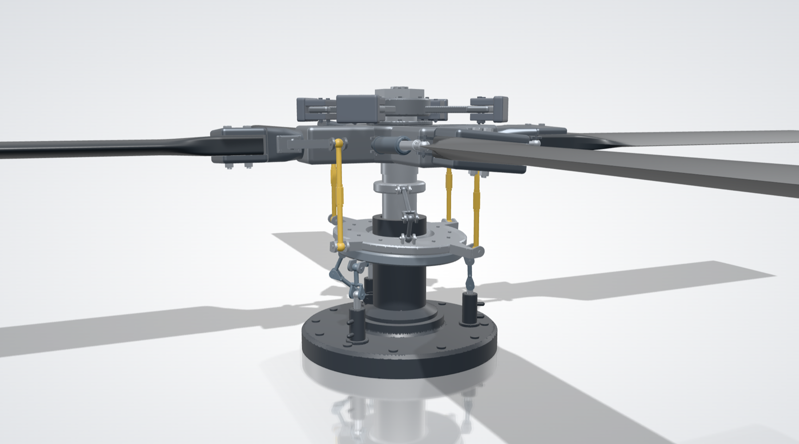
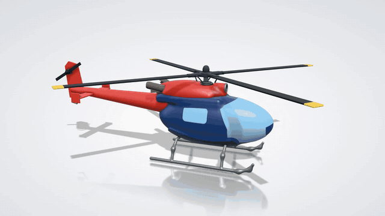
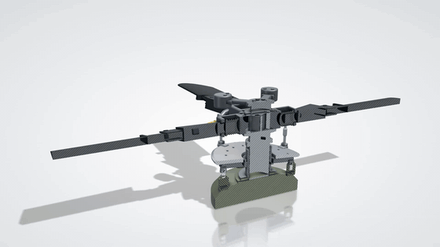
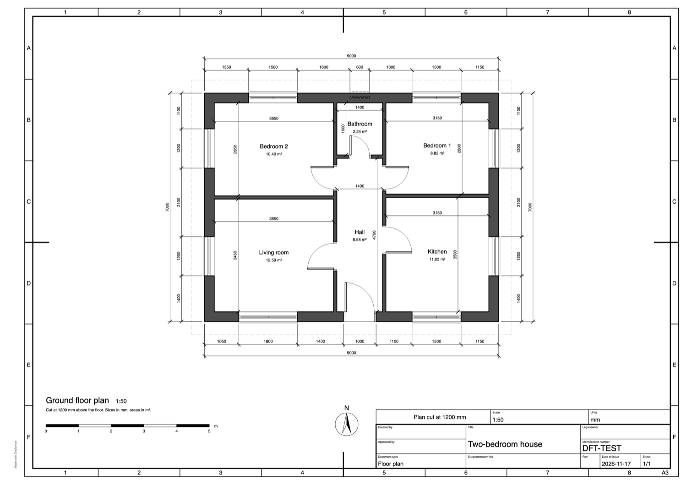

# Draftsman

[](https://github.com/abhinavbolla/draftsman/actions/workflows/ci.yml)
[](LICENSE)

**CAD you talk to.** Describe a part, a machine or a house, and Claude draws it in 3D, in real dimensions, with parts that move. Look around it, cut it open, click a part to change it, and export a drawing, a film or a file for other apps.



| | | |
|---|---|---|
|  |  |  |
| A film of a helicopter, recorded in the app | The rotor head cut open | The floor plan of a house |

> **Draftsman is in early development.** From the first [release](https://github.com/abhinavbolla/draftsman/releases) on, each comes with installers for macOS, Windows and Linux, not signed yet. Until then it runs from a clone of this repository.
>
> Draftsman was formerly called 3D Maker.

## What works today

| | |
|---|---|
| Models from a prompt, changed by prompt or by sliders on a part | ✅ |
| Big models built from a plan, each step checked | ✅ |
| Mechanisms that move, with joint and collision checks | ✅ |
| A studio view with materials and shading in the creases, and CAD-style navigation | ✅ |
| Looking inside: hide parts, cut the model open, explode it, and measure sizes, mass and distances | ✅ |
| Export: PNG pictures; STL, 3MF, glTF, OBJ, PLY and STEP files | ✅ |
| 2D drawings: views, a section, a detail, centre lines, overall sizes and hole dimensions, on A4 to A0, as SVG, PDF or DXF | ✅ |
| Installers for macOS, Windows and Linux (unsigned), and examples to start from | ✅ |
| Films: a camera Claude directs, turntables and shot lists, recorded frame by frame | ✅ |
| Houses: walls, doors, windows, rooms and a roof, with a floor plan sheet (first stage) | ✅ |
| Signed installers | Planned |

The [roadmap](docs/roadmap.md) has the plan.

## Install

Download the installer for your system from the [releases page](https://github.com/abhinavbolla/draftsman/releases). You also need [Claude Code](https://claude.com/claude-code), installed and logged in, and [Node.js](https://nodejs.org) 20 or newer. The [guide](docs/using.md#install) says what to do when your system warns about an unsigned app.

## Run it

Or run it from a clone. You need Node 20 or newer and [Claude Code](https://claude.com/claude-code), installed and logged in. The desktop app also needs Rust and Xcode's command line tools.

```bash
npm install
npm run app        # desktop app
npm start          # or in your browser, at http://localhost:5173
```

## Your first model

- **Or start from an example.** An empty window offers a few ready models; open one and change it.
- **Describe it.** Type "a desk lamp with a weighted base" in the box at the bottom and press Enter. Claude builds it, looks at it, and fixes what looks wrong.
- **Go big.** For a helicopter or an engine, Claude makes a plan and builds it one checked step at a time.
- **Change a part.** Click it, then move its sliders or type "make this longer".
- **Look around.** Drag to turn, right-drag or two fingers to slide, scroll or pinch to zoom. The view cube looks from any side.
- **Undo.** ⌘Z undoes every change, Claude's included.
- **Export** a PNG picture, a drawing sheet (SVG, PDF or DXF), an outline to cut, or an STL, 3MF, STEP, glTF, OBJ or PLY file.

The [guide](docs/using.md) has every gesture and key, and what Claude can draw.

## Why Draftsman

- **You describe; Claude draws.** There are no tool palettes to learn. It runs on the Claude Code you already have, with no API key.
- **It is a model, not a picture.** Real millimetres, separate named parts, and mechanisms that are checked as they move.
- **It is yours.** MIT licensed, on our own geometry kernel, and a model is a short script you can read and keep.

## How it works

The prompt box starts your own `claude -p`, which drives the app through an MCP server. Claude writes the model as a short script. Our own kernel turns it into solids with signed distance fields, so joining and cutting shapes cannot fail. [docs/architecture.md](docs/architecture.md) walks through it.

## Benchmarks

On 20 of CADPrompt's 200 parts, every part built, at 0.916 IoGT. Eight complex moving objects average 6.4 out of 10 from a judge. [docs/benchmarks.md](docs/benchmarks.md) has the results and how to run them.

## Limitations

- **Exact surfaces only for simple parts.** STEP files hold exact solids for primitives, extrusions and revolves; other parts are flat faces from the mesh.
- **Drawings are early.** One sheet per drawing; holes, bosses, steps and wall thicknesses are dimensioned, but not radii, angles, chamfers or tolerances.
- **No dragging.** You change a model with prompts and sliders.
- **Fine detail on big parts** is limited by the mesh: a 1 mm engraving on a 10 m fuselage comes out rough.
- **Unsigned installers.** macOS and Windows warn you the first time you open the app.

The [guide](docs/using.md#limitations) lists the rest.

## Contributing

Contributions are welcome: see [CONTRIBUTING.md](CONTRIBUTING.md). Please report security problems privately, as [SECURITY.md](SECURITY.md) describes.

## License

[MIT](LICENSE). CI checks the license of every dependency.
