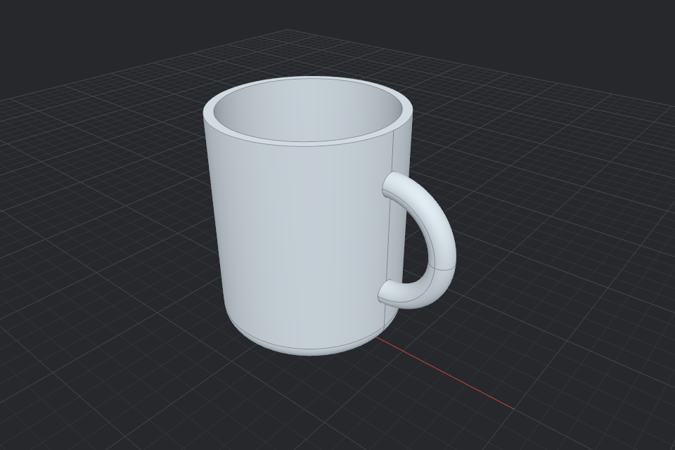

# 3D Maker

A small CAD modeller you can drive with Claude. It runs on a real B-rep kernel (OpenCascade), so models are exact solids with fillets, chamfers, shells and booleans, and it exports STL for printing and STEP for other CAD tools.



Claude connects through a local MCP server and uses your own Claude plan, so the app has no AI bill and no API key. You watch the model update while Claude works, and you can edit anything it makes by hand.

## Run it

You need Node 20 or newer. The desktop app also needs Rust and Xcode's command line tools.

```bash
npm install
npm run app        # desktop app (Tauri)
npm start          # or: open it in your browser at http://localhost:5173
```

## Connect Claude

Click **Connect Claude** in the app for commands with your paths filled in. For Claude Code:

```bash
claude mcp add --scope user 3d-maker -- node /path/to/3d-maker/mcp/server.mjs
```

For Claude Desktop, add this to `~/Library/Application Support/Claude/claude_desktop_config.json` and restart it:

```json
{ "mcpServers": { "3d-maker": { "command": "node", "args": ["/path/to/3d-maker/mcp/server.mjs"] } } }
```

Keep the app open, then ask Claude something like “In 3D Maker, model a coffee mug with a handle, 80 mm wide.”

## Using it

- Units are millimetres and Z is up. Left-drag orbits, right-drag pans, and scroll zooms.
- **Add** a shape: box, cylinder, cone, sphere, torus, extrude (polygon) or revolve (profile around Z).
- Click an object to select it. Edit exact values in the right panel, or use the gizmo: W move, E rotate, R scale. **Snap** rounds to 1 mm and 15°.
- **Combine**: ⇧-click two or more objects, then Union, Subtract or Intersect. The first one you click is the target. The inputs stay editable inside the boolean, and **Split** undoes it.
- **Features**: fillet, chamfer (all, top, bottom or vertical edges) and shell (hollow with an open top or bottom).
- ⌘Z / ⇧⌘Z undo and redo, ⌘S save, ⌘O open, ⌘D duplicate, F fits the view. The scene is also autosaved and restored on the next start.

Edits that would break a solid, such as a fillet too large for its edges, are rejected and the model stays as it was.

## Claude's tools

`get_scene`, `add_shape`, `update_shape`, `delete_shape`, `boolean`, `split_boolean`, `add_feature`, `duplicate`, `undo`, `redo`, `new_scene`, `screenshot` (returns a PNG of any standard view, so Claude can check its work), `export_model` (STL or STEP to a file).

## How it fits together

```
Claude Code / Claude Desktop ──stdio──▶ mcp/server.mjs ──WebSocket 127.0.0.1:7457──▶ app
                                                                       │
                                     src/main.js (UI) ◀── src/app/store.js ──▶ worker: src/kernel (OpenCascade)
```

- `src/model`: the scene document (plain JSON) and pure edit operations
- `src/kernel`: turns the document into solids, meshes and exports; runs in a web worker
- `src/app`: viewport (Three.js), state and undo, the MCP bridge, files
- `mcp/server.mjs`: the MCP server; it forwards tool calls to the open app
- `src-tauri`: the desktop shell (native file dialogs only)

The bridge only accepts connections from the app itself (checked by WebSocket origin) on localhost.

## Tests

```bash
node test/kernel.test.mjs   # kernel: every shape, a mug, STL and STEP export
node test/mcp.test.mjs      # MCP end to end; needs the app open
node test/check-stl.mjs model.stl   # checks an STL is well formed and closed
```

## Not done yet

- Sketches and curves: no 2D sketching with constraints, splines, or NURBS surfaces (loft, sweep). The kernel supports them; the app does not expose them yet.
- Edge picking: fillets and chamfers select edge groups (all, top, bottom, vertical), not individual edges you click.
- Rhino-style precision tools: object snaps, a command line, multiple viewports, layers.
- Packaging: the desktop app runs from this folder (`npm run app`), and the MCP server needs Node. There is no signed installer yet, and the app icon is Tauri's placeholder.
- An in-app chat panel. Claude works through your own Claude Code or Claude Desktop.

## Licenses

Code dependencies are MIT, Apache-2.0, BSD or ISC, except the OpenCascade wasm build (`replicad-opencascadejs`), which is LGPL-2.1. It ships as a separate, replaceable `.wasm` file.
