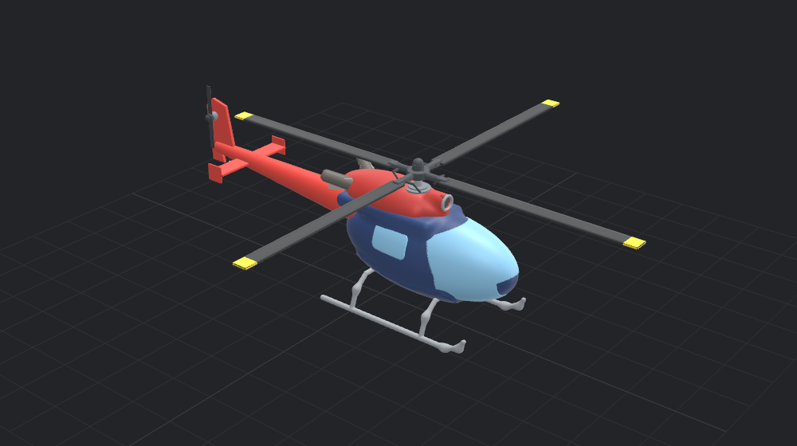

# 3D Maker

Describe what you want to make, and Claude builds it as a 3D model you can 3D print. Click any part to tweak it with a few sliders, or select it and describe the change.



It runs on the Claude Code you already have, on your own Claude plan. There is no API key and no AI bill.

## Run it

You need Node 20 or newer, and [Claude Code](https://claude.com/claude-code), installed and logged in (run `claude` once in a terminal). The desktop app also needs Rust and Xcode's command line tools.

```bash
npm install
npm run app        # desktop app
npm start          # or the same app in your browser, at http://localhost:5173
```

## Using it

- Type what you want in the box at the bottom and press Enter, for example "a desk lamp with a weighted base" or "a helicopter whose rotors spin". Claude writes the model, looks at it from a few angles, and fixes what looks wrong.
- Big or mechanical things (a helicopter, a rotor head, an engine) are built with a plan: Claude lists the sub-assemblies and their parts, then builds and checks them one at a time. A line above the prompt shows progress, like "5 of 20 done · now: Stationary swashplate". The app only lets a step count as done once all its parts exist and are solid.
- Under Claude's reply, a grey line says what this window saw happen: whether the model changed, how many changes and looks, and any step that failed. It is counted by the app, not taken from Claude's words.
- Click a part to select it. Its sliders appear in the top-right corner, and the prompt box now talks about that part ("make this longer").
- Claude can draw real outlines (arcs, curves, splines, rounded corners, airfoil sections) and turn them into solids by extruding, spinning (all the way or part way), sweeping them along a path (rails, bent tube, springs, seals) or lofting through several of them (wings, blades, hulls, bottles). A body can also be drawn as its side, top and front outlines, the way it is drawn on paper; the solid is what they share (fuselages, car bodies, cabs). Claude is told what makes a vehicle look real: proportions from real dimensions first, outlines before detail, and the features the eye knows it by, as separate pieces.
- Shapes can be twisted, tapered and bent (a bar bent into a ring, a label wrapped round a mug), filled with lattices (gyroid, diamond, square grid or honeycomb infill, with a solid skin if wanted), and wrapped in a convex hull. Text is drawn in our own single-stroke font, in the style of technical drawing lettering, to raise or engrave.
- Real hardware at ISO metric sizes: threaded rods, bolts (hex, socket and countersunk heads), nuts and washers, and holes that are clearance-drilled, tapped, counterbored or countersunk for them. A bolt made at the same spot as its hole fits it. Moulded parts can have draft on their sides.
- The app checks how parts fit: which parts pass into each other, how deep and where, at rest and through the whole motion, so a rotor blade that strikes the tail during its turn is found. Claude sees this after each step of a plan and fixes it (cutting a hole where a shaft goes into a hub, for example). Parts pinned together at a joint may overlap around the pin, in moving and still models alike; each joint covers one pin, so overlap at the other copies of a part made of copies is still listed. Threads count as fitting when they mate.
- Parts move in the view, and mechanisms work: a crank drives its rod and piston, a swashplate pitches rotor blades through their pitch links. Claude declares every joint (each pin, ball joint and rod end), and the app checks over the whole motion that no joint comes apart, so a mechanism that only looks right in one frame is caught. Pause stops the motion.
- Drag to orbit, right-drag to pan, scroll to zoom, F to fit the view, Esc to deselect.
- ⌘Z / ⇧⌘Z undo and redo every change, Claude's included. ⌘S saves, ⌘O opens, ⌘E exports an STL; the Export menu also has one-solid STL and 3MF. The model is also autosaved.

Export writes every visible part at the same detail, meshed in parallel, so a 60-part rotor head exports in seconds:

- **STL**: each part its own closed shell in one file, ready for a slicer.
- **STL, one solid**: every part joined into one closed solid, to print in one piece (slower: one solid is meshed on one core).
- **3MF**: one named, coloured object per part, for slicers and other CAD tools.

## How it works

```
prompt box ──▶ your `claude -p` (Claude Code) ──stdio──▶ mcp/server.mjs ──WebSocket──▶ app
                                                                                       │
                     model script ──▶ kernel workers: run script, mesh parts ──▶ 3D view
```

- **Models are short scripts.** Claude writes JavaScript in a small modelling language (`sphere`, `capsule`, `revolve`, `union(..., smooth)`, `.symmetric("y")`, `.radial(4)`, `part(...)`, `param(...)`). Motion is part of the script too: a part can `follow` another, move by any function of time (`turn`, `slide`, `link` for rigid rods, `where` to track a point on another part), and `joint` declares connections the app checks. The full reference is the instructions in [mcp/server.mjs](mcp/server.mjs). Sliders are `param()` values, so a tweak re-runs the script and nothing downstream breaks.
- **Our own geometry kernel** ([src/kernel](src/kernel)). Shapes are signed distance fields: a function that says how far any point is from the surface. Joining, cutting, blending and hollowing are a line of math each and cannot fail. The mesher refines coarse to fine near the surface, uses dual contouring so sharp edges stay sharp, adds detail where parts are thin, and repairs pinched spots, so every mesh is closed. A part made by adding small pieces to a body (bolts on a hub) is meshed piece by piece, so each small piece gets cells that suit its size instead of the body's. Detail is shared out by surface area (the fine pass uses the real surface of the preview meshes, so a rotor spread over 16 m does not starve the fuselage), so a big part is as detailed as a small one; each change shows a quick preview first, then the same model meshed finer in the background (Claude's screenshots wait for that). In the view, vertices are split along sharp edges, so each face is shaded flat to its edge instead of smearing into the next. Fit checks ([src/kernel/fit.js](src/kernel/fit.js)) work on the distance functions directly, with no meshes: space is split into boxes, searched deepest overlap first, and a box is settled as soon as its centre's distances show it is wholly inside both parts or outside one.
- **The prompt box** starts your own `claude -p` with this app's MCP server and only its tools allowed. The desktop app does this from Rust ([src-tauri/src/lib.rs](src-tauri/src/lib.rs)); the browser version uses a small endpoint in the dev server ([vite.config.js](vite.config.js)). Follow-up prompts continue the same Claude conversation.
- Each window has its own id. A Claude run started from a window drives only that window, even with several windows or browser tabs open. The bridge only accepts the app itself (checked by WebSocket origin) on localhost.

You can also drive the app from Claude Code or Claude Desktop directly by adding the MCP server:

```bash
claude mcp add --scope user 3d-maker -- node /path/to/3d-maker/mcp/server.mjs
```

## Tests

```bash
npm test                               # kernel, window routing, plan tools; no Claude needed (needs Chrome)
npm run test:e2e                       # the real prompt box with your real Claude Code (see below)
npm run try -- "a rotor head"          # one prompt, saves pictures, script and plan in runs/
node test/mcp.test.mjs                 # the MCP tools against an open app
node test/check-stl.mjs model.stl      # checks an STL is well formed and closed
node test/check-3mf.mjs model.3mf      # checks a 3MF: zip, names, colours, every part closed
node test/export-run.mjs runs/x/model.js  # loads a saved script and times its STL export
cd src-tauri && cargo test -- --include-ignored   # finds and runs your Claude Code
```

`npm run test:e2e` opens two app windows in headless Chrome, types two prompts into the first ("a 30 mm cube with a 10 mm hole", then, with it selected, "make this 50 mm wide") and checks the result by measuring it, not by reading Claude's reply: the part's size from its mesh, the hole from its volume, a closed STL, and that the second window was not touched. A third prompt (a desk fan) must be built with a plan, with every step finished and every planned part present. It needs Google Chrome and uses a little of your Claude plan. It does not drive the desktop window itself (WebDriver for Tauri does not run on macOS); the desktop app's way of starting Claude is covered by the Rust test.

## Not done yet

- No exact CAD surfaces: export is STL and 3MF meshes (no STEP), and curved surfaces are fine meshes rather than exact curves. This is the price of a kernel where nothing fails.
- Very fine detail cut into a very large part (a 1 mm engraved logo on a 10 m fuselage) is limited by that part's mesh detail, and features smaller than a mesh cell (a 5 mm bevel on a 7 mm cell) come out saw-toothed. Small pieces added to a big part keep their own detail. The view uses lighter meshes than the export.
- No dragging parts around in the view; changes are sliders or prompts.
- Collisions in motion are checked at up to 120 moments of the loop; a very fast part could pass through something between two of them.
- Threads are real helical solids, but on a big model they are finer than the mesh and look like smooth rods.
- Text has one font, and only the characters listed in the reference (no accents yet). Lattices with very thick walls are limited to walls 30% of a cell.
- Packaging: the app runs from this folder. It finds the MCP server and Node here, so there is no installer, no signing and no real icon yet.
- Running your own `claude -p` from an app is fine for your own use. Check Anthropic's terms before giving the app to others.

## Licenses

Our code has no license yet. Dependencies are MIT (three.js, MCP SDK, ws, zod, Vite, Tauri's JS packages) or MIT/Apache-2.0 (Tauri). One build-time-only dependency of Vite, lightningcss, is MPL-2.0; it is not shipped in the app.
