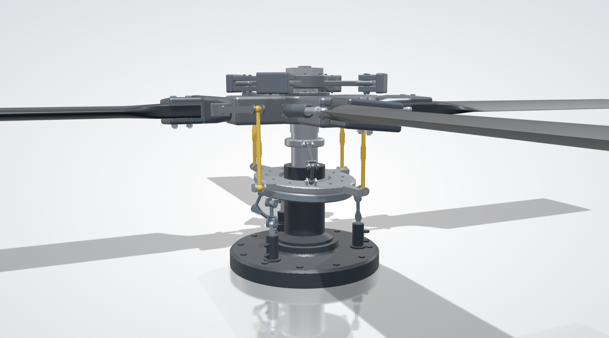

# 3D Maker

[](https://github.com/abhinavbolla/3d-maker/actions/workflows/ci.yml)
[](LICENSE)

**CAD you talk to.** Describe a part or a whole machine, and Claude draws it in 3D, in real dimensions, with parts that move. Look around it, click a part to change it, and export a picture or a file for other apps.



> **3D Maker is in early development.** It runs from a clone of this repository, and there is no installer yet. See [what works today](#what-works-today) and the [roadmap](docs/roadmap.md).

## Why 3D Maker

CAD takes years to learn, and the tools that make good models are closed and expensive. 3D Maker is built around three ideas:

- **You describe; Claude draws.** There are no tool palettes to learn. You type what you want, and you point at a part to change it. It runs on the [Claude Code](https://claude.com/claude-code) you already have, on your own Claude plan, with no API key and no AI bill.
- **It is a model, not a picture.** Everything is in millimetres. Parts are separate, named solids. Mechanisms really work: a crank drives its piston, a swashplate pitches its blades, and the app checks that joints hold and parts don't collide through the whole motion.
- **It is yours.** The code is MIT licensed, the geometry kernel is our own, and a model is a short, readable script you can keep, edit and share.

## What works today

| | Status |
|---|---|
| Models from a prompt, changed by prompt or by sliders on a part | ✅ Works |
| Big models built from a plan, step by step, each step checked | ✅ Works |
| Mechanisms that move, with joint and collision checks | ✅ Works |
| Studio view: shadows, a reflecting floor, metal, paint, rubber and glass | ✅ Works |
| Moving freely around the model | ✅ Works |
| Pictures (PNG) | ✅ Works |
| Mesh export: STL and 3MF | ✅ Works |
| 2D drawings: views, sections and dimensions | Planned |
| Export for other CAD apps (STEP) | Planned |
| Videos of a model, directed by Claude | Planned |
| Installers for macOS, Windows and Linux | Planned |

The [roadmap](docs/roadmap.md) has the full plan and what stands between this and a professional CAD tool.

## Run it

You need Node 20 or newer, and [Claude Code](https://claude.com/claude-code), installed and logged in (run `claude` once in a terminal). The desktop app also needs Rust and Xcode's command line tools.

```bash
npm install
npm run app        # desktop app
npm start          # or the same app in your browser, at http://localhost:5173
```

## Using it

**Making things**

- Type what you want in the box at the bottom and press Enter: "a desk lamp with a weighted base", "a helicopter whose rotors spin". Claude writes the model, looks at it from a few angles, and fixes what looks wrong.
- Big or mechanical things (a helicopter, a rotor head, an engine) are built with a plan. Claude lists the sub-assemblies and their parts, then builds and checks them one at a time. A line above the prompt shows progress, like "5 of 20 done · now: Stationary swashplate". A step only counts as done once all its parts exist and are solid.
- Under Claude's reply, a grey line says what this window saw happen: whether the model changed, how many changes and looks, and any step that failed. The app counts this itself; it is not taken from Claude's words.
- Click a part to select it. Its sliders appear in the top-right corner, and the prompt box now talks about that part ("make this longer").
- ⌘Z and ⇧⌘Z undo and redo every change, Claude's included. ⌘S saves and ⌘O opens. The model is also autosaved.

**Looking around**

- Drag to turn the view. It turns around the middle of the window, which starts as the middle of the model, and the model stays upright. While you turn, a ring marks that centre, and the origin's axes and its three planes show.
- Right-drag or shift-drag to slide the view. On a trackpad, slide two fingers.
- Scroll with a mouse wheel, or pinch on a trackpad, to move towards what the pointer is on. Over empty space you keep flying, so you can travel to any part of a big model and look at it up close.
- Double-click a point to bring it to the middle; the view then turns around it. Fit (or F) frames the whole model from a corner, and Esc deselects.
- The view cube at the bottom right turns with the model. Click a side, an edge or a corner to look from there without losing your place, or drag the cube to turn the view. Its red, green and blue lines are the X, Y and Z axes, and the red and green lines on the ground are the X and Y axes.
- Moving parts play in the view; Pause stops them.

**What Claude can draw**

- Real outlines (arcs, curves, splines, rounded corners, airfoil sections), turned into solids by extruding, spinning, sweeping along a path (rails, bent tube, springs) or lofting through several of them (wings, blades, hulls, bottles).
- Bodies from their side and top outlines, the way they are drawn on paper, with rounded cross-sections (fuselages, car bodies, cabs).
- Shapes that are twisted, tapered and bent, lattice infill (gyroid, diamond, grid, honeycomb), convex hulls, and raised or engraved text in our own single-stroke font.
- Real hardware at ISO metric sizes: threads, bolts, nuts, washers, and the clearance, tapped, counterbored or countersunk holes that fit them. Moulded parts can have draft.
- Materials: metal, paint, plastic, rubber and glass.
- Motion: parts that turn, slide, follow each other or are linked by rods. Claude declares every joint, and the app checks over the whole motion that no joint comes apart and no parts pass into each other.

**Getting it out**

The Export menu saves:

- **Picture**: the view as a studio shot on a light backdrop, as a PNG.
- **3MF**: one named, coloured object per part, for other 3D apps and slicers.
- **STL**: each part its own closed shell, or all parts joined into one solid.

Every visible part is meshed at the same detail on all cores, so a 60-part rotor head exports in seconds.

## How it works

```
prompt box ──▶ your `claude -p` (Claude Code) ──stdio──▶ mcp/server.mjs ──WebSocket──▶ app
                                                                                       │
                     model script ──▶ kernel workers: run script, mesh parts ──▶ 3D view
```

- **Models are short scripts.** Claude writes JavaScript in a small modelling language (`sphere`, `capsule`, `revolve`, `union(..., smooth)`, `.symmetric("y")`, `.radial(4)`, `part(...)`, `param(...)`). Motion is part of the script too: a part can `follow` another, move by any function of time (`turn`, `slide`, `link` for rigid rods, `where` to track a point on another part), and `joint` declares connections the app checks. The full reference is the instructions in [mcp/server.mjs](mcp/server.mjs). Sliders are `param()` values, so a tweak re-runs the script and nothing downstream breaks.
- **Our own geometry kernel** ([src/kernel](src/kernel)). Shapes are signed distance fields: a function that says how far any point is from the surface. Joining, cutting, blending and hollowing are a line of math each and cannot fail. The mesher refines coarse to fine near the surface, uses dual contouring so sharp edges stay sharp, adds detail where parts are thin, and repairs pinched spots, so every mesh is closed. A part made by adding small or thin pieces to a body (bolts on a hub, wire spokes in a wheel) is meshed piece by piece, so each piece gets cells that suit its size instead of the body's. A flat part whose edges taper thinner than a cell (a rotor blade, a wing, a keel) is meshed stretched up to 8x through its thickness and squeezed back, so its trailing edge comes out straight instead of bitten, without filling its broad faces with cells. Detail is shared out by surface area (the fine pass uses the real surface of the preview meshes, so a rotor spread over 16 m does not starve the fuselage), so a big part is as detailed as a small one; each change shows a quick preview first, then the same model meshed finer in the background (Claude's screenshots wait for that). In the view, vertices are split along sharp edges, so each face is shaded flat to its edge instead of smearing into the next. Fit checks ([src/kernel/fit.js](src/kernel/fit.js)) work on the distance functions directly, with no meshes: space is split into boxes, searched deepest overlap first, and a box is settled as soon as its centre's distances show it is wholly inside both parts or outside one.
- **The prompt box** starts your own `claude -p` with this app's MCP server and only its tools allowed. The desktop app does this from Rust ([src-tauri/src/lib.rs](src-tauri/src/lib.rs)); the browser version uses a small endpoint in the dev server ([vite.config.js](vite.config.js)). Follow-up prompts continue the same Claude conversation.
- Each window has its own id. A Claude run started from a window drives only that window, even with several windows or browser tabs open. The bridge only accepts the app itself (checked by WebSocket origin) on localhost.

[docs/architecture.md](docs/architecture.md) walks through a prompt end to end and every file of the kernel.

You can also drive the app from Claude Code or Claude Desktop directly by adding the MCP server:

```bash
claude mcp add --scope user 3d-maker -- node /path/to/3d-maker/mcp/server.mjs
```

## Tests

```bash
npm test                               # kernel, window routing, plan tools; no Claude needed (needs Chrome)
npm run test:e2e                       # the real prompt box with your real Claude Code (see below)
npm run try -- "a rotor head"          # one prompt, saves pictures, script and plan in runs/
node test/mcp.test.mjs                 # the MCP tools against an open app
node test/check-stl.mjs model.stl      # checks an STL is well formed and closed
node test/check-3mf.mjs model.3mf      # checks a 3MF: zip, names, colours, every part closed
node test/export-run.mjs runs/x/model.js  # loads a saved script and times its STL export
cd src-tauri && cargo test -- --include-ignored   # finds and runs your Claude Code
```

### Benchmarks

Both use your real Claude Code and a fair amount of your Claude plan. Results go to `runs/bench/` (not in git), and a stopped run picks up where it left off.

```bash
node test/bench/objects.mjs --parallel 2      # our 8 complex, moving objects, scored by a judge
node test/bench/cadprompt.mjs --per 5         # 20 of CADPrompt's 200 single parts, scored against their real meshes
node test/render-run.mjs runs/x/model.js runs/x "Part A,Part B"   # pictures and fit check of a saved script, no Claude
```

- **Objects** ([test/bench/objects.json](test/bench/objects.json)): a helicopter, drone, robot arm, race car, watch, yacht, office chair and engine. A fresh Claude that sees only the prompt and the pictures, not the builder's reply, scores recognisability, proportions, form, detail and mechanism from 1 to 10. It looks three times and the scores are averaged, because one look varies by about ±1. Next to the scores are what the app measures: parts, overlaps, a closed STL and time.
- **CADPrompt** (Alrashedy et al., ICLR 2025): the most-cited text-to-CAD benchmark. It has 200 descriptions of single mechanical parts, each with a ground-truth mesh. The dataset is not in this repo because it states no licence. Fetch it with `git clone https://github.com/Kamel773/CAD_Code_Generation runs/bench/cadprompt-src`.
  - **Prompt wording:** its prompts ask for "Python code using CADQuery", so that request is dropped and the description kept.
  - **Scoring:** [test/bench/mesh-score.mjs](test/bench/mesh-score.mjs) follows the paper. Both meshes are scaled into the unit cube, sampled to 1,000 points and aligned with ICP. A failed model scores √3 point-cloud distance and 0 IoGT.
  - **Two scores:** "as built" starts the alignment from the model's own orientation, as the paper does. "Any turn" also tries the other right-angle turns.
  - **Caveats:** the paper ships no scoring code, so this is our reading of it. The paper's best is 0.127 point-cloud distance and 0.944 IoGT (GPT-4 with CADCodeVerify, all 200 parts); a 20-part subset is not directly comparable.

`npm run test:e2e` opens two app windows in headless Chrome, types two prompts into the first ("a 30 mm cube with a 10 mm hole", then, with it selected, "make this 50 mm wide") and checks the result by measuring it, not by reading Claude's reply: the part's size from its mesh, the hole from its volume, a closed STL, and that the second window was not touched. A third prompt (a desk fan) must be built with a plan, with every step finished and every planned part present. It needs Google Chrome and uses a little of your Claude plan. It does not drive the desktop window itself (WebDriver for Tauri does not run on macOS); the desktop app's way of starting Claude is covered by the Rust test.

## Limitations

- **No exact CAD surfaces yet.** Export is meshes (STL, 3MF), not STEP, and curved surfaces are fine meshes rather than exact curves. This is the price of a kernel where joining and cutting cannot fail. The [roadmap](docs/roadmap.md) says what we plan to do about it.
- **No 2D drawings yet.**
- **Fine detail on big parts.** A 1 mm engraving on a 10 m fuselage is limited by that part's mesh, and features smaller than a mesh cell come out saw-toothed. The very tip of a sharp trailing edge is a few mm short. Threads on a big model look like smooth rods.
- **Changes are prompts and sliders.** You can't drag parts around in the view.
- **Collisions in motion** are checked at up to 120 moments of the loop; a very fast part could pass through something between two of them.
- **Text** has one font and no accents yet.
- **Packaging.** The app runs from this folder, so there is no installer, signing or real icon yet.
- Running your own `claude -p` from an app is fine for your own use. Check Anthropic's terms before giving the app to others.

## Contributing

Contributions are welcome. [CONTRIBUTING.md](CONTRIBUTING.md) explains how to set up, test and open a pull request. Please report security problems privately, as described in [SECURITY.md](SECURITY.md).

## License

3D Maker is licensed under the [MIT License](LICENSE).

Its dependencies are MIT (three.js, MCP SDK, ws, zod, Vite, Tauri's JS packages) or MIT/Apache-2.0 (Tauri). One build-time-only dependency of Vite, lightningcss, is MPL-2.0; it is not shipped in the app.
