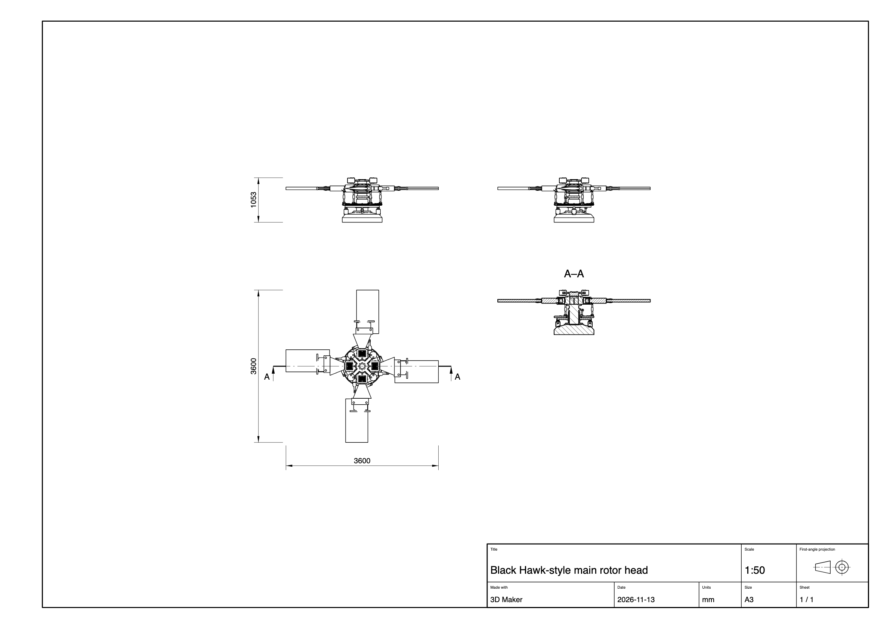

# Using 3D Maker

The [README](../README.md) gets you to a first model. This page is the full guide.

## Making things

- Type what you want in the box at the bottom and press Enter: "a desk lamp with a weighted base", "a helicopter whose rotors spin". Claude writes the model, looks at it from a few angles, and fixes what looks wrong.
- Big or mechanical things (a helicopter, a rotor head, an engine) are built with a plan. Claude lists the sub-assemblies and their parts, then builds and checks them one at a time. A line above the prompt shows progress, like "5 of 20 done · now: Stationary swashplate". A step only counts as done once all its parts exist and are solid.
- Under Claude's reply, a grey line says what this window saw happen: whether the model changed, how many changes and looks, and any step that failed. The app counts this itself; it is not taken from Claude's words.
- Click a part to select it. Its sliders appear in the top-right corner, and the prompt box now talks about that part ("make this longer").
- ⌘Z and ⇧⌘Z undo and redo every change, Claude's included. ⌘S saves and ⌘O opens. The model is also autosaved.

## Looking around

- Drag to turn the view. It turns around the middle of the window, which starts as the middle of the model, and the model stays upright. While you turn, a ring marks that centre, and the origin's axes and its three planes show.
- Right-drag or shift-drag to slide the view. On a trackpad, slide two fingers.
- Scroll with a mouse wheel, or pinch on a trackpad, to move towards what the pointer is on. Over empty space you keep flying, so you can travel to any part of a big model and look at it up close.
- Double-click a point to bring it to the middle; the view then turns around it. Fit (or F) frames the whole model from a corner, and Esc deselects.
- The view cube at the bottom right turns with the model. Click a side, an edge or a corner to look from there without losing your place, or drag the cube to turn the view. Its red, green and blue lines are the X, Y and Z axes, and the red and green lines on the ground are the X and Y axes.
- Moving parts play in the view; Pause stops them.

## What Claude can draw

- Real outlines (arcs, curves, splines, rounded corners, airfoil sections), turned into solids by extruding, spinning, sweeping along a path (rails, bent tube, springs) or lofting through several of them (wings, blades, hulls, bottles).
- Bodies from their side and top outlines, the way they are drawn on paper, with rounded cross-sections (fuselages, car bodies, cabs).
- Shapes that are twisted, tapered and bent, lattice infill (gyroid, diamond, grid, honeycomb), convex hulls, and raised or engraved text in our own single-stroke font.
- Real hardware at ISO metric sizes: threads, bolts, nuts, washers, and the clearance, tapped, counterbored or countersunk holes that fit them. Moulded parts can have draft.
- Materials: metal, paint, plastic, rubber and glass.
- Motion: parts that turn, slide, follow each other or are linked by rods. Claude declares every joint, and the app checks over the whole motion that no joint comes apart and no parts pass into each other.

## Getting it out

The Export menu saves:

- **Picture**: the view as a studio shot on a light backdrop, as a PNG.
- **3MF**: one named, coloured object per part, for other 3D apps and slicers.
- **STL**: each part its own closed shell, or all parts joined into one solid.
- **Drawing**: an A3 sheet as an SVG, which browsers, Inkscape and Illustrator open and print.

Every visible part is meshed at the same detail on all cores, so a 60-part rotor head exports in seconds.

### The drawing



The sheet shows the model from the front, from above and from the left, laid out in first-angle projection (the ISO way: the top view sits under the front view, and the view from the left sits on its right). Hidden edges are left out. Next to them is section A–A: the model cut by a plane, with the cut faces hatched, each part its own way, and what lies beyond the cut drawn behind them. The cutting line and the way the section looks are marked on one of the views.

The overall width, depth and height are dimensioned in millimetres. The title block gives the model's title, the scale and the date. The scale is the largest standard one that fits the sheet: 1:1, 1:2, 1:5, 1:10, 1:20, 1:50 and so on, or 2:1, 5:1 and up for small parts.

From the Export menu the section cuts across the model's longest side, at its middle. Ask Claude for a different one: "export a drawing with the section across z, 40 mm up".

Parts are drawn where the script puts them, not as their motion poses them, the same as in the STL and 3MF files. The views are drawn from the same meshes as those files, so a line can be off by the mesh's detail; the section is not, because it is cut from the exact shapes.

## Driving it from Claude Code

The prompt box is the usual way in. You can also drive the app from Claude Code or Claude Desktop directly by adding the MCP server:

```bash
claude mcp add --scope user 3d-maker -- node /path/to/3d-maker/mcp/server.mjs
```

## Limitations

- **No exact CAD surfaces yet.** Export is meshes (STL, 3MF), not STEP, and curved surfaces are fine meshes rather than exact curves. This is the price of a kernel where joining and cutting cannot fail. The [roadmap](roadmap.md) says what we plan to do about it.
- **Drawings are a first version.** One A3 sheet as SVG: no PDF or DXF, no isometric view, no dashed hidden edges, and only the overall sizes are dimensioned. Where a small piece of a part rises out of a bigger piece of the same part (a boss on a curved body), the line where they meet is not drawn yet.
- **Fine detail on big parts.** A 1 mm engraving on a 10 m fuselage is limited by that part's mesh, and features smaller than a mesh cell come out saw-toothed. The very tip of a sharp trailing edge is a few mm short. Threads on a big model look like smooth rods.
- **Changes are prompts and sliders.** You can't drag parts around in the view.
- **Collisions in motion** are checked at up to 120 moments of the loop; a very fast part could pass through something between two of them.
- **Text** has one font and no accents yet.
- **Packaging.** The app runs from this folder, so there is no installer, signing or real icon yet.
- **Sharing the app.** Running your own `claude -p` from an app is fine for your own use. Check Anthropic's terms before giving the app to others.
