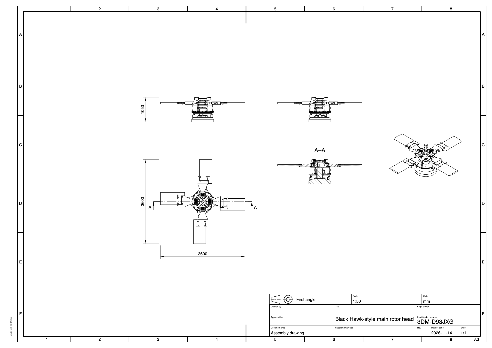

# Using Draftsman

The [README](../README.md) gets you to a first model. This page is the full guide.

## Install

Download the installer for your system from the [releases page](https://github.com/abhinavbolla/draftsman/releases): a `.dmg` for macOS (`aarch64` for Apple silicon, `x64` for Intel), an `.msi` or `-setup.exe` for Windows, and a `.deb`, `.rpm` or `.AppImage` for Linux.

Before Draftsman can draw, you need two things it does not install for you:

- **[Claude Code](https://claude.com/claude-code)**, installed and logged in: run `claude` once in a terminal and log in. Draftsman runs it for every prompt, on your own Claude plan; there is no API key to enter.
- **[Node.js](https://nodejs.org) 20 or newer.** It runs the small server that connects Claude Code to the app window.

Without them the app still opens, shows the examples and opens and exports files, and the prompt box says which one is missing.

The installers are not signed yet, so your system warns you the first time:

- **macOS** says it cannot check the app, or that it is damaged. Open it once, then in System Settings, Privacy & Security, click **Open Anyway**. Or run `xattr -dr com.apple.quarantine "/Applications/Draftsman.app"` in Terminal.
- **Windows** says "Windows protected your PC". Click **More info**, then **Run anyway**.

To run it from the source instead, see the [README](../README.md#run-it).

## Making things

- On an empty window, a few examples sit above the prompt box: a mug, a bracket with bolts, a rotor head that moves and a helicopter. Choosing one opens it at once, without Claude, and it is then your model like any other. The prompt box suggests two changes to try on it.

- Type what you want in the box at the bottom and press Enter: "a desk lamp with a weighted base", "a helicopter whose rotors spin". Claude writes the model, looks at it from a few angles, and fixes what looks wrong.
- Big or mechanical things (a helicopter, a rotor head, an engine) are built with a plan. Claude lists the sub-assemblies and their parts, then builds and checks them one at a time. A line above the prompt shows progress, like "5 of 20 done · now: Stationary swashplate". A step only counts as done once all its parts exist and are solid.
- Under Claude's reply, a grey line says what this window saw happen: whether the model changed, how many changes and looks, and any step that failed. The app counts this itself; it is not taken from Claude's words.
- Click a part to select it. Its sliders appear in the top-right corner, and the prompt box now talks about that part ("make this longer").
- ⌘Z and ⇧⌘Z undo and redo every change, Claude's included. ⌘S saves and ⌘O opens. The model is also autosaved.

## Looking around

- Drag to turn the view. It turns around the middle of the window, which starts as the middle of the model, and the model stays upright. While you turn, a ring marks that centre, and the origin's axes and its three planes show.
- Right-drag or shift-drag to slide the view. On a trackpad, slide two fingers.
- Scroll with a mouse wheel, or pinch on a trackpad, to move towards what the pointer is on. Over empty space you keep flying, so you can travel to any part of a big model and look at it up close.
- Double-click a point to bring it to the middle; the view then turns around it. Fit (or F) frames the whole model from a corner, and Esc deselects.
- The view cube at the bottom right turns with the model. Click a side, an edge or a corner to look from there without losing your place, or drag the cube to turn the view. Its red, green and blue lines are the X, Y and Z axes, and the red and green lines on the ground are the X and Y axes.
- To look inside, ask: "hide the blades", "show only the hub", "cut it in half so I can see the gearbox", "explode it". Hidden parts are not drawn and cannot be clicked. A section cuts the model with a plane and fills the cut faces, so solids look solid; you can ask for parts to be left whole. An exploded view moves the parts apart, keeping the parts of each plan step together. While any of this is on, a line above the prompt box says so, such as "Section at Y = 0 mm · 3 parts hidden"; click it or press Esc to show the whole model again (the first Esc deselects a part). It changes only the view: exports, drawings and undo see the whole model.
- Ask for numbers rather than judging by eye: "how far is the mast from the tail boom?", "what does the hub weigh in aluminium?". Claude measures sizes, volumes, surface areas, centres of mass and masses, the shortest distance between two parts and the distance between two points, from the exact shapes as the script places them.
- Moving parts play in the view; Pause stops them. They play at up to 60 frames a second, and at 30 while you work in another window (typing to Claude beside the app, say). While the window is hidden they wait, and go on from where they were when it shows again.

## What Claude can draw

- Real outlines (arcs, curves, splines, rounded corners, airfoil sections), turned into solids by extruding, spinning, sweeping along a path (rails, bent tube, springs) or lofting through several of them (wings, blades, hulls, bottles).
- Bodies from their side and top outlines, the way they are drawn on paper, with rounded cross-sections (fuselages, car bodies, cabs).
- Shapes that are twisted, tapered and bent, lattice infill (gyroid, diamond, grid, honeycomb), convex hulls, and raised or engraved text in our own single-stroke font.
- Real hardware at ISO metric sizes: threads, bolts, nuts, washers, and the clearance, tapped, counterbored or countersunk holes that fit them. Moulded parts can have draft.
- Materials: metal, paint, plastic, rubber and glass.
- Motion: parts that turn, slide, follow each other or are linked by rods. Claude declares every joint, and the app checks over the whole motion that no joint comes apart and no parts pass into each other.

## Getting it out

The Export menu saves:

- **Picture**: the view as a studio shot on a light backdrop, as a PNG.
- **3MF**: one named, coloured object per part, for other 3D apps and slicers.
- **STL**: each part its own closed shell, or all parts joined into one solid.
- **STEP**: solids for CAD programs such as FreeCAD or Fusion, one named, coloured part each, in an assembly. See below for which parts come out exact.
- **Drawing**: an A3 sheet as an SVG, which browsers, Inkscape and Illustrator open and print.
- **Drawing, PDF**: the same sheet as a PDF at its real size, to print or send.
- **Drawing, DXF**: the same sheet as a DXF for 2D CAD programs, on layers: VISIBLE, HIDDEN, CENTRE, SECTION, HATCH, DIMENSIONS, DETAIL, FRAME and TITLE.
- **Outline, DXF**: one section alone at true size (1:1, in mm, no sheet), for a laser or water-jet cutter.
- **glTF**: a .glb file for Blender, game engines and web viewers. Each part is a named node with its colour and material (metal, paint, plastic, rubber or glass), and the model's motion is an animation that loops, so a mechanism plays there as it does here. glTF is in metres with Y up, so the file is too; apps that read it put the model the right way up and the right size.
- **OBJ**: one object per part, with normals, in millimetres with Y up, as most apps expect an OBJ. Its colours and materials go in an MTL file of the same name beside it; keep the two together.
- **PLY**: one mesh, each vertex coloured with its part's colour, in millimetres with Z up, like the STL. The part names are in comment lines in its header.

Motion goes only into the glTF file; the other files hold the parts where the script puts them.

Every visible part is meshed at the same detail on all cores, so a 60-part rotor head exports in seconds.

### STEP

A STEP file holds exact surfaces; our kernel holds distance fields, so a part comes out exact only where its script says exactly what it is, without any 3D cut or join:

- a box (with square edges), cylinder (with or without rounded ends), cone, sphere, torus or capsule;
- an extrusion of an outline made of lines and arcs: rects, circles, polygons, `path()` with `line`, `arc`, `radiusArc` and `tangentArc`, rounded corners, and holes cut wholly inside the outline with `.cut()` (no draft);
- a revolve of such an outline, all the way round or part of the way;
- any of these moved, turned, scaled the same in every direction or mirrored, `symmetric()` where the shape lies to one side, and several of them in one part (`union`, `radial`, `array`) where their boxes do not touch.

Those come out as true planes, cylinders, cones, spheres and tori, bounded by lines and circles. Everything else (any `.cut()` or `union` in 3D where shapes meet, smooth blends, rounded boxes, sweeps, lofts, threads, text, twists) comes out as a closed solid of flat faces made from the part's mesh. Neighbouring flat triangles become one face, so flat parts stay light, but a curved faceted part is a few hundred to a few thousand faces. To keep files a sane size, faceted parts are meshed coarser than for STL: 1000 surface cells plus 400 per faceted part, at most 6000, over all of them, shared out by surface area, at least 150 per part. A part that the coarse cells break up (a thin tube whose volume comes out more than 8% short) is meshed again finer, up to about 4000 triangles. The 47-part rotor head (all faceted) comes to about 20 MB, the 21-part helicopter example (8 parts exact) about 13 MB. A visible part that the view itself could not mesh (a plate thinner than its cells) is left out unless it is exact, and named. After an export, the app says how many parts came out exact, and Claude tells you which.

The files are checked by a STEP reader of our own (`node test/check-step.mjs`): every solid closed, every vertex on its curves and surfaces, volumes and sizes matching the model. They have not yet been opened in a CAD program; if one refuses a file, please open an issue with it.

### The drawing



The sheet shows the model from the front, from above and from the side, with hidden edges left out, and where there is room an isometric view at the top right. Next to the views is section A–A: the model cut by a plane, with the cut faces hatched, each part its own way, and what lies beyond the cut drawn behind them. The cutting line and the way the section looks are marked on one of the views.

The views are laid out in first-angle projection (ISO: the top view under the front view, the view from the left on its right) or third-angle projection (the top view above it, the view from the right on its right). Which one follows the region your system's language names: third angle in the US, Canada and Japan, first angle elsewhere, and first angle (ISO's) when no region is named. Say "third angle" or "first angle" to change it.

Holes and turned parts get centre lines. On a drawing of up to three parts, the sheet carries every size needed to make the parts, each once and on the view that shows it best. Holes and bosses seen end on get their diameters (equal holes together, as "4× ⌀9"; a tapped hole by its thread, as "M6"; a blind hole with its depth, as "⌀5, 12 deep") and their positions, measured from the largest part's left and bottom edges on one running dimension line each way. A hole that is not seen end on (under a boss, say) is sized on the section instead, as a length with the diameter sign. The section also gives the heights of steps (a boss above a plate) and the thicknesses of plates and walls. The sizes are the script's own values, not measurements: a `hole(9, 10)` is called out as ⌀9. A round hole the script does not describe as a cylinder (a bore in a revolved or lofted part) is found by fitting a circle to the view, and the app says how close the fit is. A bigger assembly gets centre lines only; its parts' sizes belong on their own drawings. Labels go where nothing else is, on the part's face next to their hole when there is room; a leader never crosses a dimension line or another leader, and a size that finds no room is left out with a word from the app.

The overall width, depth and height are dimensioned in millimetres. The scale is the largest standard one that fits the sheet: 1:1, 1:2, 1:5, 1:10, 1:20, 1:50 and so on, or 2:1, 5:1 and up for small parts. Outlines are 0.5 mm wide and dimensions and hatching 0.25 mm, or thinner where a crowded assembly would run together at that weight.

The sheet follows ISO 5457 (frame, grid reference border, centring marks), and its title block ISO 7200. The block fills itself in:

| Field | Where it comes from |
| --- | --- |
| Title | The model's title. A title too long for its cell is split near its 30th character, and the rest goes in the supplementary title (or, if you gave one, the title gets smaller letters). A title too long even for that is cut short with … on the sheet, and the app says so. |
| Identification number | Made up once for the model (such as DFT-4K7Q2X) and saved with it, until you give your own. A number saved by an older version of the app is kept as it is. |
| Date of issue | Today. |
| Document type | Part drawing, or Assembly drawing for more than one part. |
| Scale, projection, units, sheet | From the sheet itself. |
| Created by, legal owner | Blank until you say. The app does not know your name or employer and does not guess. |
| Approved by | Blank, a line to sign, unless you name the approver when you ask for the drawing. An approval is for one issue of a drawing, so it is never remembered: the next drawing has the empty line again. |
| Revision, general tolerances | Blank until you say; the app never changes a revision by itself. The tolerances note only appears when you give one. |

To fill in or change any of it, tell Claude, for example: "export a drawing, drawn by Ana Ruiz, owner Example Works Ltd, drawing number BRK-0042, revision A, tolerances ISO 2768-m". Each field holds what ISO 7200 recommends: 20 characters for created by and approved by, 16 for the number, 2 for the revision, 50 for the supplementary title; 40 for the legal owner and 30 for the tolerances, which it leaves open. A longer value is refused with a message saying so, never cut short on the sheet. Ask for a field to be left empty to clear it; an empty number gets a new one made up.

The app remembers what you said once the drawing is saved; a drawing that fails, or whose save you cancel, leaves nothing remembered:

- **Kept for you, in this app only:** your name (created by), the legal owner, and first or third angle. They are never written into a model file.
- **Kept with the model, and saved in its file:** the number, revision, supplementary title and general tolerances. No one's name is saved in a model file. Claude rewriting the script keeps them, since it is still the same model; New starts a model with none of them, and so a new number. Open brings in the file's own.

After each drawing the app says in one line what went on the sheet: what you said, what was remembered, what is blank, and how to change it.

The section goes through the axes of holes, so they show at their full size: on a drawing of a few parts, through the most holes (then the plane that keeps the larger scale, then the biggest bore); otherwise across the longest side, moved onto the axis of a turned part it passes close to (a rotor mast). Ask Claude for a different one: "export a drawing with the section across z, 40 mm up". A section given within a hole's radius of its axis is moved onto the axis, and the app says so.

More you can ask for:

- **Hidden edges dashed**: "with hidden lines". Edges behind other surfaces are drawn as narrow dashed lines on the front, top and side views, never over a visible line. For that drawing only.
- **Another sheet size**: "on A4" (upright) or A2, A1, A0 (across). The frame, its grid and the scale follow the sheet; the title block stays in the bottom right corner.
- **A detail view**: "with a detail of the hub". A crowded place of one view is drawn again in a free part of the sheet at a larger standard scale (at least twice the sheet's), as view B with its scale, and a circle and the letter B mark it on the view it comes from. Claude can say which view and where, or let the app pick the most crowded place.
- **PDF or DXF**: "as a PDF", "as a DXF".
- **An outline to cut**: "a DXF of the plate's outline for the laser cutter". With no other say, the section goes across the model's thinnest side, at its middle, so it cuts through a plate rather than along it; a view's outline ("the top view's outline") works too, from the mesh. Round loops come out as true circles.

Parts are drawn where the script puts them, not as their motion poses them, the same as in the STL and 3MF files. The views are drawn from the same meshes as those files, so a line can be off by the mesh's detail; the section is not, because it is cut from the exact shapes.

## Driving it from Claude Code

The prompt box is the usual way in. You can also drive the app from Claude Code or Claude Desktop directly by adding the MCP server:

```bash
claude mcp add --scope user draftsman -- node /path/to/draftsman/mcp/server.mjs
```

## Limitations

- **Exact CAD surfaces only for simple parts.** STEP export writes exact surfaces for boxes, cylinders, cones, spheres, tori, capsules, and extrusions and revolves of line-and-arc outlines; a part with a 3D cut, a join of touching shapes, a smooth blend or a free-form shape is written as flat faces from its mesh. This is the price of a kernel where joining and cutting cannot fail. The [roadmap](roadmap.md) says what we plan to do about it.
- **Drawings are early.** One sheet per drawing, no parts list, and besides the overall sizes only holes, bosses, steps and wall thicknesses are dimensioned (no radii, angles, chamfers, counterbores or tolerances). Where a small piece of a part rises out of a bigger piece of the same part (a boss on a curved body), the line where they meet is not drawn yet.
- **Fine detail on big parts.** A 1 mm engraving on a 10 m fuselage is limited by that part's mesh, and features smaller than a mesh cell come out saw-toothed. The very tip of a sharp trailing edge is a few mm short. Threads on a big model look like smooth rods. A wall much thinner than the part's mesh cells (a 0.5 mm tube 400 mm long) is drawn a little more than a cell thick until the finer mesh comes in, so it is whole but too thick.
- **Changes are prompts and sliders.** You can't drag parts around in the view.
- **Collisions in motion** are checked at up to 120 moments of the loop; a very fast part could pass through something between two of them.
- **Text** has one font and no accents yet.
- **Unsigned installers.** Until the builds are signed, macOS and Windows warn you the first time you open the app (see [Install](#install)). There are no automatic updates.
- **Sharing the app.** Running your own `claude -p` from an app is fine for your own use. Check Anthropic's terms before giving the app to others.
